<h1 align="center">Raykookie</h1>

<strong>Confeitaria feita à mão, do forno para a sua mesa: o cardápio e o pedido na palma da mão.</strong>

  
  
  
  
  
  
  

  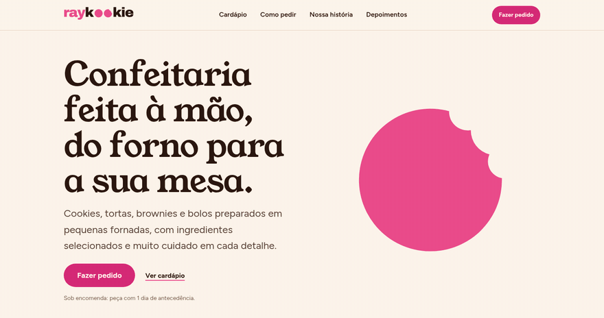

---

## Visão geral dos apps cliente

A Raykookie é uma confeitaria artesanal que trabalha **sob encomenda**. Este repositório guarda os dois apps que o cliente usa para pedir:

- **Site** (Next.js): a vitrine da casa. Funciona em qualquer navegador e é pensado para quem chega do Instagram, com o polegar.
- **App Android** (Flutter): o mesmo mundo no celular, com a conta sempre à mão e avisos quando o pedido muda de etapa. O APK é baixado direto do site.

Para quem quer um doce, seja para presentear, comemorar ou matar a vontade da semana, o caminho é curto:

| O que a pessoa faz | Como o produto ajuda |
|---|---|
| **Escolher** | Cardápio sempre atual, com fotos, categorias e combos. Dá para compartilhar o cardápio por link (e, no app, por QR code). |
| **Pedir** | Pedido em 5 passos rápidos. Entra com o Google ou com e-mail e senha, e o que já foi escolhido não se perde no login. |
| **Acompanhar** | Linha do tempo do pedido (recebido, em preparo, pronto, entregue) e aviso no celular a cada mudança. |
| **Cuidar dos próprios dados** | Tela "Meus dados" com exportação e exclusão da conta. |

> O painel de gestão da confeiteira vive no mesmo repositório, mas não é assunto deste README.

---

## Galeria de telas

> Todas as telas abaixo são capturas reais do site e do app rodando, com **dados fictícios** (cliente, pedidos e preços de exemplo).

  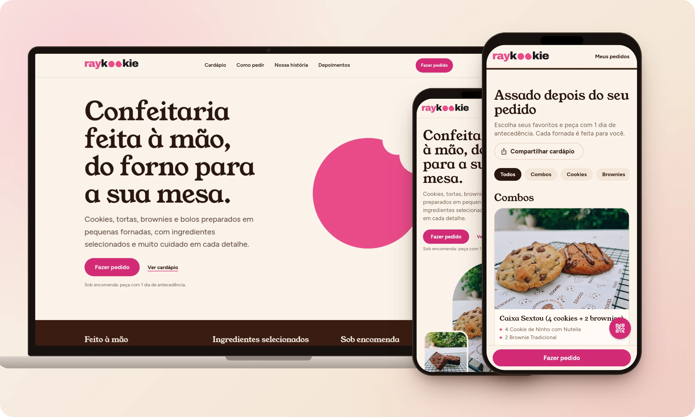

### Site (desktop)

<table>
  <tr>
    <td width="50%" align="center">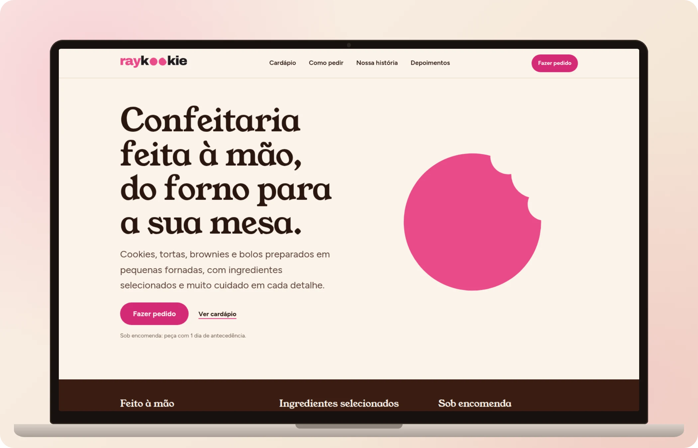 <b>Início</b>: a casa em uma frase e um botão de pedir sempre à vista.</td>
    <td width="50%" align="center">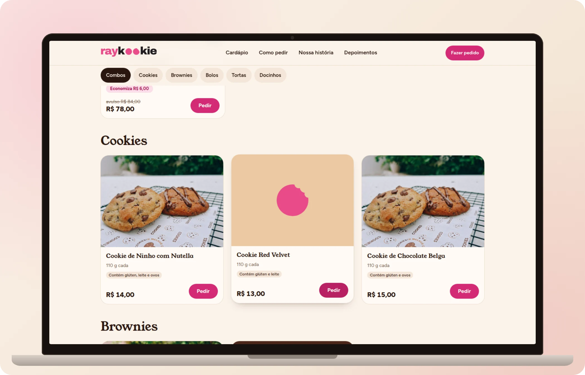 <b>Cardápio</b>: fotos, selos de alérgenos e um botão Pedir em cada item.</td>
  </tr>
  <tr>
    <td align="center"> <b>Novo pedido</b>: o total acompanha a pessoa na parte de baixo.</td>
    <td align="center">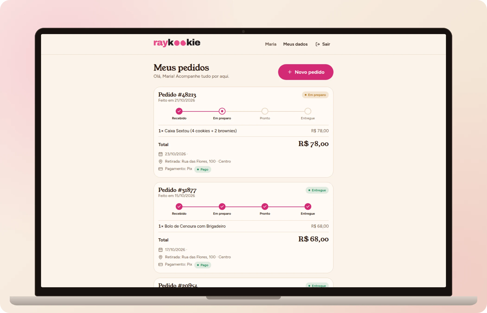 <b>Meus pedidos</b>: linha do tempo e situação do pagamento.</td>
  </tr>
  <tr>
    <td align="center" colspan="2">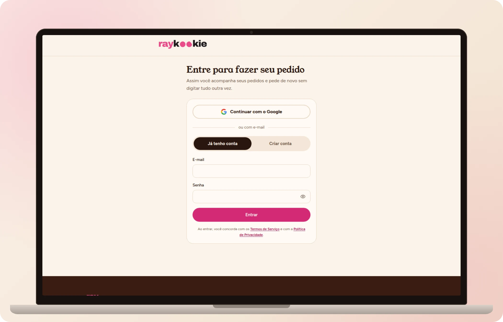 <b>Entrar</b>: com o Google ou com e-mail e senha.</td>
  </tr>
</table>

**O site em movimento**

<table>
  <tr>
    <td align="center"> Da apresentação ao cardápio.</td>
    <td align="center">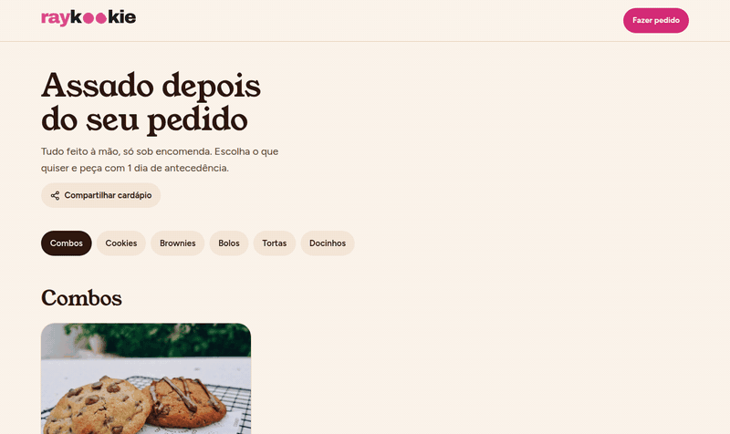 Do cardápio ao pedido, a um clique.</td>
  </tr>
</table>

### App Android

  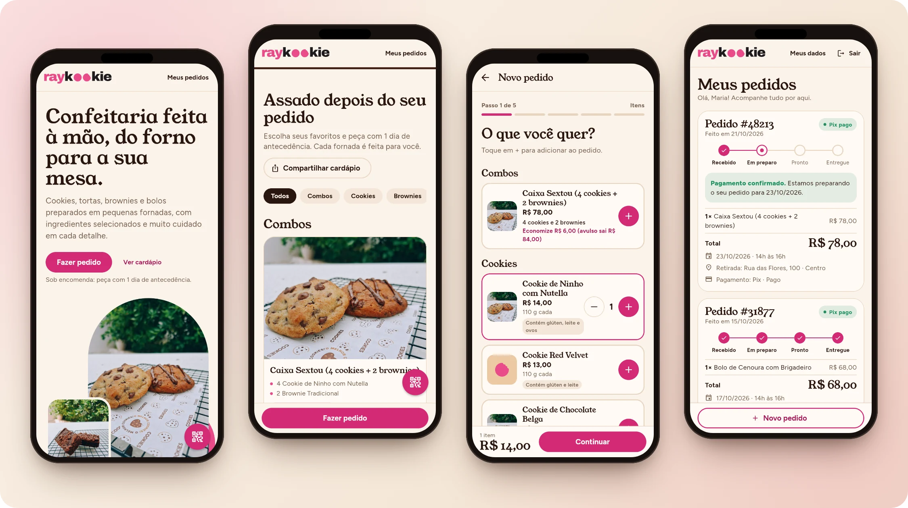

<table>
  <tr>
    <td width="33%" align="center">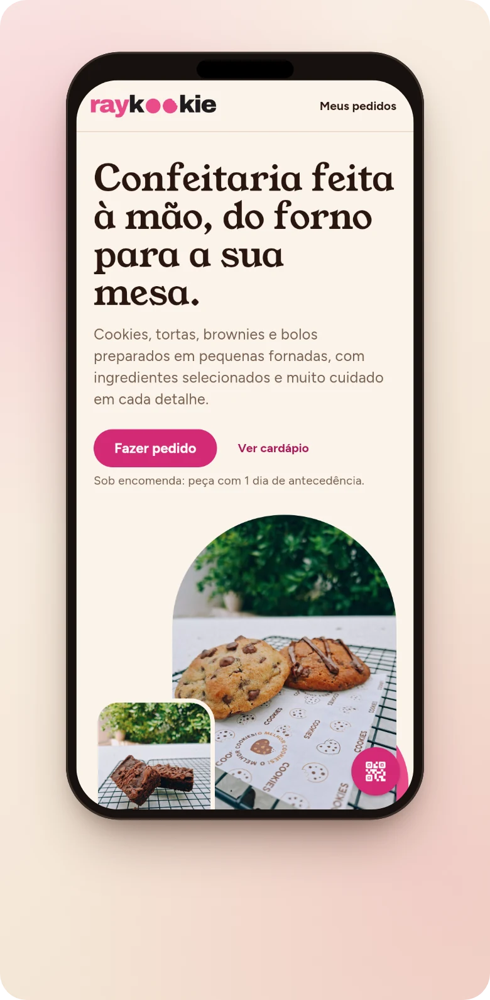 <b>Início</b></td>
    <td width="33%" align="center">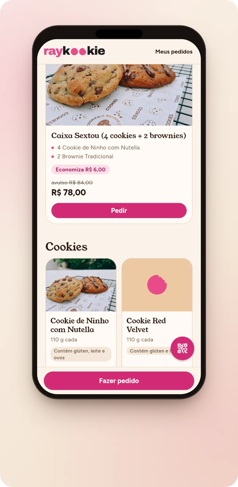 <b>Cardápio</b>: sem foto, entra o símbolo da marca.</td>
    <td width="33%" align="center">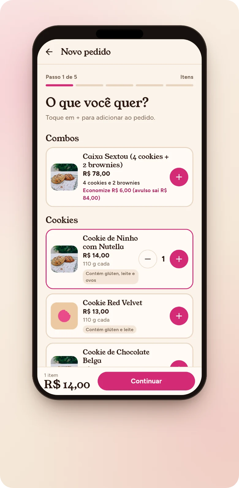 <b>Novo pedido</b> em 5 passos.</td>
  </tr>
  <tr>
    <td align="center"> <b>Meus pedidos</b></td>
    <td align="center"> <b>Entrar</b></td>
    <td align="center">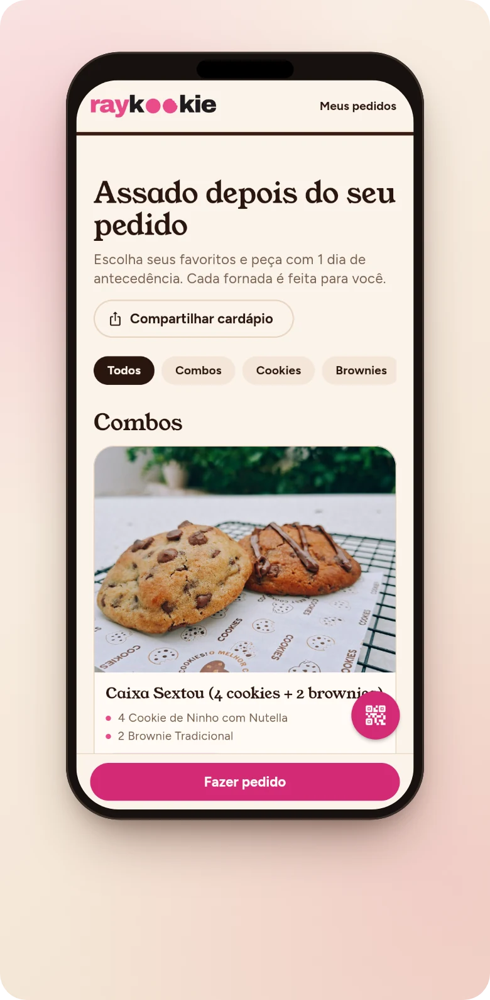 <b>Categorias</b> a um toque.</td>
  </tr>
</table>

**O app em movimento**

<table>
  <tr>
    <td align="center">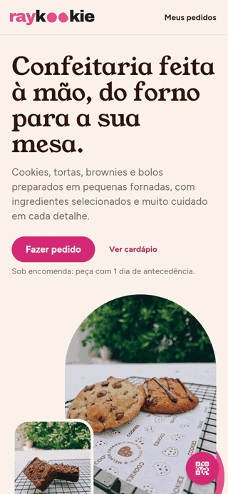 Navegando pelo cardápio.</td>
    <td align="center">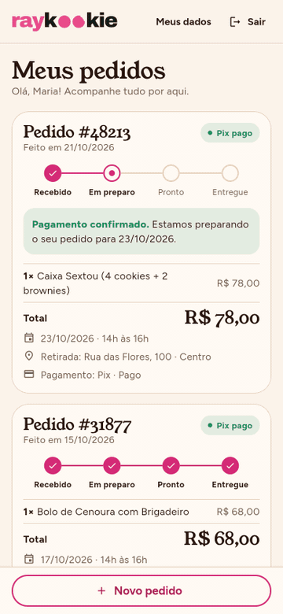 Montando um pedido.</td>
  </tr>
</table>

> As capturas do app vêm do mesmo código Flutter compilado para web e aberto em uma janela de celular (390×844), contra uma API de mentira. A moldura do aparelho é desenhada em HTML/CSS; o conteúdo da tela é o do app.

---

## Animação da tela inicial

O biscoito rosa do logo aparece inteiro, **treme, leva três mordidas** (com migalhas saltando de cada uma) e se assenta no logo estático. O GIF do topo é a animação real, gravada do site rodando. Há também uma versão em vídeo: [`docs/media/hero-loop.mp4`](docs/media/hero-loop.mp4).

**Como foi feita** ([`frontend/lib/logo-intro.ts`](frontend/lib/logo-intro.ts) e [`frontend/components/LogoIntro.tsx`](frontend/components/LogoIntro.tsx)):

- **anime.js v4, uma linha do tempo só**: entrada, tremor, três mordidas e migalhas no mesmo relógio.
- **SVG puro, sem imagem**: a geometria vem do próprio path do logo (um disco menos três círculos). Durante a cena, as mordidas são círculos de *máscara* que crescem do zero, então são transparentes de verdade em qualquer fundo.
- **Migalhas com física simples**: polígonos irregulares, cada um com impulso, pulinho, gravidade, giro e fade.
- **O final é o logo oficial**: ao terminar, a cena é trocada pelo path do arquivo de marca. O estado final é o logo, sem sobra de transformação, máscara ou migalha.
- **Repete no hover** (no celular, no toque). A repetição parte do logo pronto, "refaz" o biscoito e termina de novo no logo, por isso o GIF fecha o loop sem corte: o primeiro e o último quadro da gravação são idênticos (diferença de pixel igual a zero).

**Performance e acessibilidade**

- A biblioteca de animação é carregada sob demanda (`import()` dinâmico): fica fora do JS inicial da página.
- Só começa quando pelo menos metade do logo está na tela (`IntersectionObserver`).
- Tudo é escrito como atributo SVG a cada quadro, sem estilo inline sobrando.
- `prefers-reduced-motion: reduce` mostra direto o logo pronto, sem animar nem repetir.
- O SVG tem `role="img"` e `aria-label`; sem JavaScript, um `<noscript>` mostra o logo estático.

---

## Decisões de design

**Direção**: confeitaria artesanal contemporânea, com a mesa de bancada, a massa crua, o cacau e o rosa da marca. O doce (a foto) é o protagonista; o resto é moldura quieta. Mobile-first, porque quase todo acesso vem do celular. O briefing completo está em [`frontend/PRODUCT.md`](frontend/PRODUCT.md) e [`frontend/DESIGN.md`](frontend/DESIGN.md).

**Paleta** (tokens do site em [`frontend/app/site.css`](frontend/app/site.css); o app usa os mesmos valores em [`mobile-common/lib/ui/theme.dart`](mobile-common/lib/ui/theme.dart)):

| Papel | Valor | Por quê |
|---|---|---|
| Fundo creme | `#FBF3EA` | calor de papel de padaria no lugar do branco frio |
| Tinta cacau | `#2A160F` | texto com contraste alto (15,7:1 sobre o creme, segundo o `DESIGN.md`) |
| Chocolate | `#3A1D12` | faixas escuras que dão ritmo à página |
| Rosa da marca | `#E94B8A` | preenchimento e decoração; fica raro, para ter intenção |
| Rosa de ação | `#D42A76` | botão principal (4,6:1 com texto claro) |
| Rosa de texto | `#A81857` | links e chips (6,5:1) |

O rosa da marca não é usado como cor de texto (contraste baixo no creme). Para isso existe um rosa mais escuro.

**Tipografia**: títulos em **Young Serif** (o lado caseiro, contra o logo, que é um grotesco pesado) e texto e preços em **Figtree**. As duas fontes são empacotadas com o projeto, sem pedir nada a servidor de terceiros: no site pelo `@fontsource` (só o subset latino, `font-display: swap`) e no app como arquivos de fonte.

**Forma**: moldura em arco para a foto principal (lembra a boca do forno), cartões com cantos de 24 px, botão em pílula, profundidade por tom e não por sombra.

**Sem foto, a marca ocupa o lugar**: o item sem foto mostra o símbolo do cookie sobre um tom do doce (caramelo para cookie, marrom para brownie, rosa suave para o resto). Foi uma decisão deliberada: o cardápio fica coeso mesmo quando nem todo item tem foto.

**Sistema de componentes**: o site público tem os estilos isolados sob `.rk-site` (nada vaza para a área logada). O app monta o tema em um `ThemeExtension` (`AppColors`) com versão clara e escura.

**Responsividade**: o site é mobile-first com escala de tipografia fluida; o app foi desenhado para telas de celular.

**Acessibilidade** (o que está no código):

- link "Ir para o cardápio" no topo, para quem navega por teclado;
- `lang="pt-BR"`, hierarquia de títulos e regiões nomeadas (`aria-labelledby`);
- `prefers-reduced-motion` respeitado no splash do logo, na rolagem suave e nas animações de entrada e de revelação por rolagem;
- no app, rótulos `Semantics` nas telas de pedido e de pedidos;
- as diretrizes de projeto são WCAG AA, foco visível e alvos de toque de pelo menos 44 px (registradas no `PRODUCT.md`).

**Tema escuro**: o app tem uma variante "à noite", com chocolate no lugar do creme. O site (público e área do cliente) é só claro.

---

## Decisões de SEO (site)

Só o que existe no código:

- **Metadados**: `title` com modelo (`%s · Raykookie`), `description`, `keywords`, `applicationName`, `metadataBase` e **URL canônica** por página (`/` e `/cardapio`). Robôs com `index, follow` e `max-image-preview: large`.
- **Open Graph e Twitter Cards**: `og:*` com `locale pt_BR`, imagem de 1200×630 com texto alternativo e `summary_large_image`. O `/cardapio` repete a imagem no próprio Open Graph, senão o link compartilhado sairia sem foto.
- **`sitemap.xml`** gerado em código, com as páginas públicas (início, cardápio, termos, privacidade e exclusão de conta), frequência e prioridade.
- **`robots.txt`** gerado em código: libera o site, bloqueia a API, a área logada e o link de pagamento, mas **libera `/api/fotos/`** (a regra mais específica vence), para o Google conseguir renderizar as fotos da home.
- **`noindex` onde faz sentido**: toda a área do cliente (`/cliente/…`, que inclui o login e os pedidos). Ela continua rastreável de propósito (o `robots.txt` não a bloqueia por completo), porque o Google só lê o `noindex` se puder acessar a página.
- **Dados estruturados (JSON-LD, schema.org)**: um `@graph` com `WebSite` e `Bakery` (nome, imagem, link do cardápio, moeda e formas de pagamento aceitas, Instagram). O JSON é escapado contra injeção de `<`.
- **Manifesto web** (`manifest.webmanifest`), ícones (`.ico`, SVG e `apple-touch-icon`) e `theme-color`.
- **Verificação do Google Search Console** via metatag.
- **Estratégia de renderização**: **SSR sob demanda** nas páginas que dependem do cardápio. A home e o cardápio buscam os dados no servidor, com cache curto no `fetch`, então o HTML já chega com os itens, os nomes e as fotos; o robô não depende de JavaScript para ver o cardápio. Termos e privacidade são **estáticos**, pré-renderizados no build.
- **URLs semânticas** em português: `/cardapio`, `/termos`, `/privacidade`, `/excluir-conta`.
- **Imagens**: dimensões declaradas (sem salto de layout), `loading="lazy"` e `decoding="async"`, e `fetchPriority="high"` na primeira foto do cardápio. As fotos de vitrine da home usam versões reduzidas (800 px) e têm texto alternativo.
- **Performance**: no build de produção local, a home pesa **162 kB de JS na primeira carga** (102 kB compartilhados). As fontes são empacotadas e a biblioteca de animação é carregada sob demanda. O projeto também tem o **Vercel Speed Insights** ligado, que mede os Core Web Vitals reais em produção.

---

## Decisões técnicas

### Site

| | |
|---|---|
| **Stack** | Next.js 15 (App Router), React 19, TypeScript, Tailwind CSS 4 + CSS próprio do site público, anime.js 4, lucide-react |
| **Dados** | Server Components buscam o cardápio no servidor; só o que é interativo é Client Component |
| **Mesma origem** | o Next repassa `/api/*` à API (rewrite): do ponto de vista do navegador não há CORS e o cookie de sessão funciona sem ajustes |
| **Estado na URL** | o item escolhido e a origem do clique vão na URL; sem sessão, o login devolve a pessoa exatamente para ela. O destino pós-login é validado (`safeNext`) |
| **Erros** | se a API falhar, o cardápio público degrada para vazio em vez de derrubar a página; há página 404 própria |
| **Segurança** | cabeçalhos em todas as respostas: CSP (impondo `frame-ancestors`, `base-uri`, `object-src` e `form-action`), HSTS, `nosniff`, `X-Frame-Options`, `Referrer-Policy` e `Permissions-Policy`. A CSP completa roda em modo relatório |
| **Código compartilhado** | `shared/` guarda tipos e regras em TypeScript puro, usados pelo site |

### App Android

| | |
|---|---|
| **Stack** | Flutter, `provider` para estado, `go_router` para navegação, `http`, `intl` (pt_BR) |
| **Código comum** | o pacote [`mobile-common`](mobile-common) (API, sessão, modelos, tema e widgets) é compartilhado com o outro app da casa |
| **Navegação** | rotas declarativas com guardas: telas de pedidos exigem login e voltam ao destino certo depois (`?next=`, só caminhos internos) |
| **Sessão** | o token fica no cofre do sistema (Keystore no Android, Keychain no iOS); 401 expira a sessão e leva ao login |
| **Offline e erros** | a abertura não trava sem internet (leitura local do token, com limite de 8 s para o servidor); toda chamada tem timeout de 30 s e devolve mensagens em português: "sem conexão" e "o servidor demorou" |
| **Login** | Google (`google_sign_in`) ou e-mail e senha |
| **Avisos** | notificações push (Firebase) para mudanças no pedido, pedindo permissão com um cartão "Quer saber quando o pedido mudar?"; sem Firebase no build, o app segue sem avisos |
| **Atualização** | o app confere se há build mais novo, baixa o APK dentro dele, confere o `sha256` e abre o instalador; a confirmação final é do Android |
| **Medição** | análise de uso anônima, **desligada por padrão** (só entra com uma flag de build) |
| **Testes** | 78 testes de widget e unitários passando no app cliente, mais os do pacote comum |

---

## Sobre o negócio

A Raykookie é uma confeitaria artesanal pequena. Nasceu na cozinha de casa, com uma receita de cookie, e hoje faz cookies, brownies, tortas, bolos e docinhos. Tudo é preparado em pequenas fornadas e **somente sob encomenda**, para chegar fresco a quem pediu.

Quase toda a clientela chega pelo Instagram e decide rápido: vê as fotos, escolhe e quer pedir sem complicação. O site e o app existem para deixar esse caminho curto e claro, com um cardápio que reflete o que a casa está oferecendo, um pedido que a pessoa monta sozinha e um acompanhamento simples até o doce chegar.

O produto resolve o problema de uma operação pequena que quer manter o jeito caseiro, sem abrir mão de um atendimento organizado.

---

Documentação técnica: [arquitetura](docs/ARQUITETURA.md) e [API](docs/API.md).
